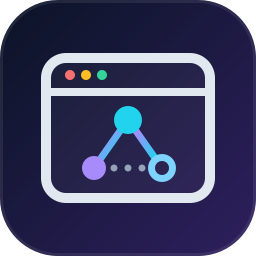
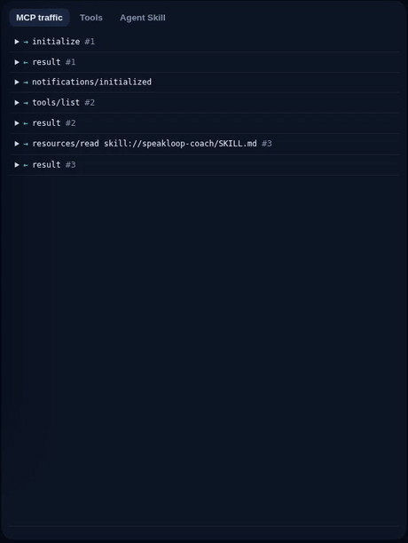
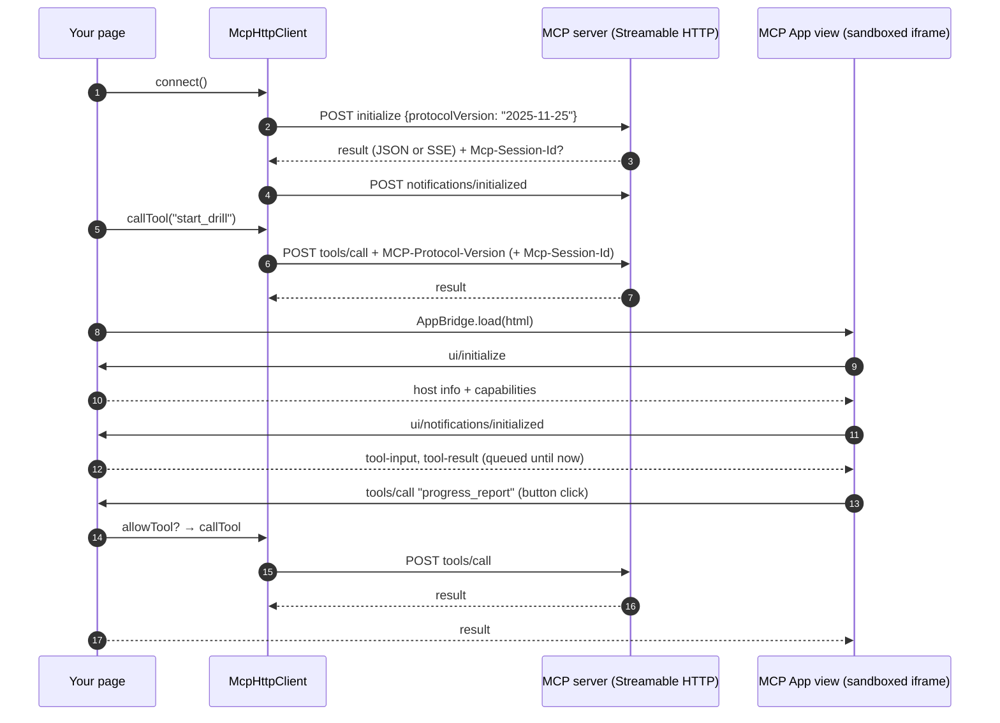
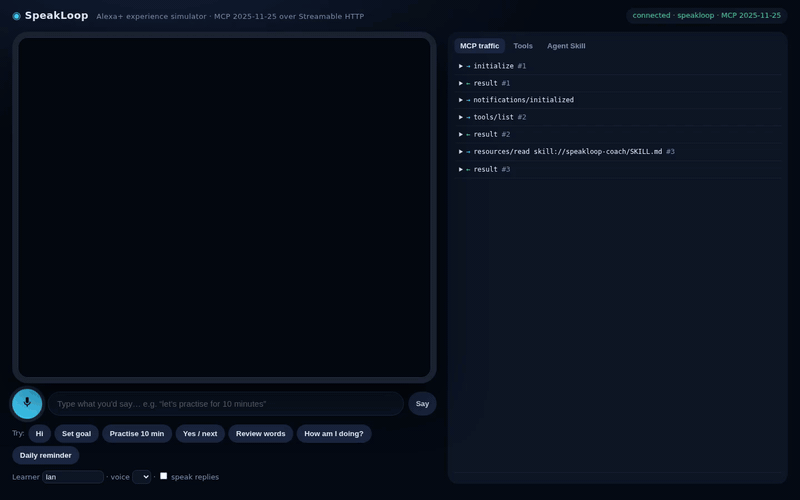

<div align="center">



# mcp-lite-browser

**A zero-dependency MCP client for the browser, plus a minimal MCP Apps host bridge.**

One ~190-line ES module. Drop it into a `<script type="module">`, no bundler, no build step,<br>
and your web page speaks the Model Context Protocol over **Streamable HTTP** (spec `2025-11-25`).

[](https://github.com/ducvuathuduc/mcp-lite-browser/actions/workflows/ci.yml)
[](#-testing)
[](package.json)
[](package.json)
[](https://modelcontextprotocol.io/specification/2025-11-25)
[](https://github.com/ducvuathuduc/mcp-lite-browser/releases)
[](LICENSE)

[Quickstart](#-quickstart) ·
[API](#-api-reference) ·
[MCP Apps](#-hosting-mcp-apps) ·
[How it works](#-how-it-works) ·
[Testing](#-testing) ·
[Roadmap](#%EF%B8%8F-roadmap)



<sub>An MCP traffic inspector built on the <code>onTraffic</code> hook, recorded in
<a href="https://github.com/ducvuathuduc/speakloop">SpeakLoop</a>'s Alexa+ simulator (6× speed).</sub>

</div>

---

## 📖 Table of contents

- [Why](#-why)
- [Features](#-features)
- [Quickstart](#-quickstart)
- [Usage examples](#-usage-examples)
- [API reference](#-api-reference)
- [Hosting MCP Apps](#-hosting-mcp-apps)
- [How it works](#-how-it-works)
- [Compatibility & limitations](#-compatibility--limitations)
- [Testing](#-testing)
- [Roadmap](#%EF%B8%8F-roadmap)
- [Used by](#-used-by)
- [Contributing](#-contributing)
- [License](#-license)
- [Acknowledgements](#-acknowledgements)

## 💡 Why

The official MCP SDKs are excellent, but they target Node and bundlers. Sometimes you just want a **plain web page**
to talk to an MCP server: a demo, a simulator, a debugging console, a kiosk, a hackathon prototype. You want to
`import` one file, call `connect()`, list tools, call them, and render the server's **MCP App** in an iframe.

`mcp-lite-browser` is that one file. It was written for the Alexa+ track of *Build, Ship, Shape: Amazon Developer
Hackathon 2026*, where self-hosted MCP servers are demoed through a web page that has to be a real MCP client, and is
published separately so anyone can reuse it.

## ✨ Features

| | |
|---|---|
| 🪶 **Zero dependencies** | One ES module (189 lines), uses only `fetch`, `postMessage` and standard DOM APIs. |
| 🤝 **Spec-correct handshake** | `initialize` with protocol-version negotiation, then `notifications/initialized`. |
| 🧾 **Streamable HTTP headers** | Sends `MCP-Protocol-Version` and `Mcp-Session-Id` on follow-up requests; `DELETE`s the session on `close()`. |
| 🌊 **JSON *and* SSE responses** | Handles `application/json` and `text/event-stream` bodies; ignores keep-alives and interleaved notifications. |
| 🧰 **Typed-feeling helpers** | `listTools`, `callTool`, `listResources`, `readResource`, `listPrompts`, `getPrompt`, plus raw `request` / `notify`. |
| 🔭 **Traffic hook** | `onTraffic(direction, message)` sees every JSON-RPC message: build an inspector in a few lines. |
| 🖼️ **MCP Apps host bridge** | `AppBridge` renders a `ui://` view in an `allow-scripts`-only sandboxed iframe and speaks the MCP Apps postMessage dialect. |
| 🔒 **Safe by default** | Tool calls from the view pass through an `allowTool` allow-list; `ui/open-link` opens only `http(s)` URLs; messages from other windows are ignored. |
| ❗ **Real errors** | JSON-RPC and HTTP failures throw `McpError` with `code` and `data`. |

## 🚀 Quickstart

There is nothing to build. Pick one way to get the file:

```bash
# A. Copy the single file into your project
curl -LO https://raw.githubusercontent.com/ducvuathuduc/mcp-lite-browser/v0.1.0/src/index.js

# B. Or install from GitHub with npm (it is not published to the npm registry)
npm install github:ducvuathuduc/mcp-lite-browser#v0.1.0
```

Then, in any page served from the **same origin** as your MCP server (or with CORS enabled on the server):

```html
<script type="module">
  import { McpHttpClient } from "./index.js";

  const client = new McpHttpClient("/mcp");          // protocolVersion defaults to "2025-11-25"
  const init = await client.connect();
  console.log(`connected to ${init.serverInfo.name}, MCP ${client.negotiatedVersion}`);

  const { tools } = await client.listTools();
  console.log(tools.map((t) => t.name));
</script>
```

A runnable page lives in [`examples/index.html`](examples/index.html): serve the repo root with any static server
and point the input at your MCP endpoint.

## 🧪 Usage examples

<details open>
<summary><b>Call a tool and read structured output</b></summary>

```js
const result = await client.callTool("start_drill", { learner_id: "lan", task_type: "repeat_sentence" });
console.log(result.structuredContent);         // machine-readable output, if the server sends it
console.log(result.content?.[0]?.text);        // text fallback
```
</details>

<details>
<summary><b>Build a traffic inspector</b></summary>

```js
const log = document.querySelector("#log");
const client = new McpHttpClient("/mcp", {
  onTraffic: (direction, msg) => {
    const arrow = direction === "out" ? "→" : "←";
    log.insertAdjacentHTML("beforeend", `<li>${arrow} ${msg.method ?? "result"} ${msg.id != null ? "#" + msg.id : ""}</li>`);
  },
});
```
</details>

<details>
<summary><b>Resources and prompts</b></summary>

```js
const { resources } = await client.listResources();
const skill = await client.readResource("skill://speakloop-coach/SKILL.md");
console.log(skill.contents[0].text);

const { prompts } = await client.listPrompts();
const p = await client.getPrompt("daily_session", { learner_id: "lan", minutes: "10" });
```
</details>

<details>
<summary><b>Handle errors</b></summary>

```js
import { McpError } from "./index.js";

try {
  await client.request("no/such-method");
} catch (e) {
  if (e instanceof McpError) console.warn(e.code, e.message, e.data);   // e.g. -32601, or the HTTP status
}
```

Note that a tool that *runs* but fails is not a protocol error: the server returns a normal result with
`isError: true`, so check `result.isError` after `callTool`.
</details>

<details>
<summary><b>Custom <code>fetch</code> (auth headers, tests, Node)</b></summary>

```js
const client = new McpHttpClient("https://example.com/mcp", {
  fetchImpl: (url, init) => fetch(url, { ...init, headers: { ...init.headers, authorization: `Bearer ${token}` } }),
  clientInfo: { name: "my-app", version: "1.2.3" },
});
```

The same option is how the test suite runs in Node without a network: it passes a fake `fetch`.
</details>

## 📚 API reference

### `new McpHttpClient(url, options?)`

| Option | Default | Description |
|---|---|---|
| `protocolVersion` | `"2025-11-25"` | Version offered in `initialize`; the server's answer is stored in `negotiatedVersion` |
| `clientInfo` | `{ name: "mcp-lite-browser", version: "0.1.0" }` | Sent in `initialize` |
| `fetchImpl` | `globalThis.fetch` | Custom fetch (auth, proxies, tests) |
| `onTraffic` | no-op | `(direction: "out" \| "in", message) => void` for every JSON-RPC message |

| Method | Returns | Notes |
|---|---|---|
| `connect()` | `initialize` result | Sends `initialize` (advertising the MCP Apps UI extension), then `notifications/initialized` |
| `listTools()` · `callTool(name, args?)` | result | `tools/list`, `tools/call` |
| `listResources()` · `readResource(uri)` | result | `resources/list`, `resources/read` |
| `listPrompts()` · `getPrompt(name, args?)` | result | `prompts/list`, `prompts/get` |
| `request(method, params?)` | result | Any JSON-RPC request; ids increase monotonically |
| `notify(method, params?)` | `null` | Any JSON-RPC notification |
| `close()` | — | `DELETE`s the session if the server issued an `Mcp-Session-Id` |

| Property | Description |
|---|---|
| `negotiatedVersion` | Protocol version the server accepted |
| `serverInfo` · `serverCapabilities` · `instructions` | From the `initialize` result |
| `sessionId` | Current `Mcp-Session-Id`, if any |

### `new AppBridge(iframe, options?)`

| Option | Default | Description |
|---|---|---|
| `client` | — | An `McpHttpClient` used to proxy the view's `tools/call` and `resources/read` |
| `hostInfo` | `{ name: "mcp-lite-host", version: "0.1.0" }` | Returned to the view in `ui/initialize` |
| `allowTool` | `() => true` | `(toolName) => boolean`; denied calls get JSON-RPC error `-32601` |
| `onToolResult` | no-op | `(name, args, result)` after a proxied tool call, to keep your agent's context in sync |
| `onSize` | no-op | `(height)` when the view reports `ui/notifications/size-changed` |

| Method | Description |
|---|---|
| `load(html)` | Renders the view in the iframe with `sandbox="allow-scripts"` and resets the queue |
| `sendToolInput(args)` | `ui/notifications/tool-input` (queued until the view is initialized) |
| `sendToolResult(result)` | `ui/notifications/tool-result` (queued until the view is initialized) |
| `destroy()` | Removes the `message` listener |

### Exports

`McpHttpClient`, `AppBridge`, `McpError`, `parseSse(text)`.

## 🖼️ Hosting MCP Apps

An MCP App is an HTML view a server exposes as a `ui://` resource (MIME `text/html;profile=mcp-app`); tools point at
it through `_meta.ui.resourceUri`. Rendering one takes four lines:

```js
import { McpHttpClient, AppBridge } from "./index.js";

const client = new McpHttpClient("/mcp");
await client.connect();
const { tools } = await client.listTools();
const result = await client.callTool("start_drill", { learner_id: "lan" });

const uri = tools.find((t) => t.name === "start_drill")._meta?.ui?.resourceUri;   // e.g. "ui://speakloop/card.html"
const html = (await client.readResource(uri)).contents[0].text;
const bridge = new AppBridge(document.querySelector("iframe"), {
  client,
  allowTool: (name) => ["start_drill", "progress_report"].includes(name),
});
bridge.load(html);
bridge.sendToolInput({ learner_id: "lan" });
bridge.sendToolResult(result);
```

| View → host message | What the bridge does |
|---|---|
| `ui/initialize` | Replies with `protocolVersion: "2026-01-26"`, `hostInfo`, capabilities and `hostContext` (dark theme, inline) |
| `ui/notifications/initialized` | Marks the view ready and flushes queued notifications |
| `ui/notifications/size-changed` | Calls `onSize(height)` |
| `tools/call` | Checks `allowTool`, proxies to the server, calls `onToolResult`, replies with the result or error |
| `resources/read` | Proxies to the server |
| `ui/open-link` | Opens `http(s)` URLs in a new tab with `noopener`; other schemes get `-32602` |
| anything else with an `id` | Replies `-32601 Unsupported` |

## 🧭 How it works



## 🧩 Compatibility & limitations

- **Protocol:** offers `2025-11-25` by default and adopts whatever version the server negotiates.
- **Servers:** used end to end by [SpeakLoop](https://github.com/ducvuathuduc/speakloop)'s simulator (see its demo
  video) against the official MCP Python SDK in stateless Streamable HTTP mode. The unit tests in this repo use a
  fake server for JSON and SSE responses.
- **Browsers:** any modern browser with ES modules and `fetch`. **Node ≥ 18** for tests (CI: 18, 20, 22).
- **CORS:** serve the page from the same origin as the MCP server, or enable CORS on the server.
- **Not yet supported:** server-initiated requests (sampling, elicitation, roots), the standalone `GET` SSE stream and
  resumption, request cancellation and timeouts, OAuth flows. See the [roadmap](#%EF%B8%8F-roadmap).
- **MCP Apps:** implements the subset a typical card view needs (see the table above), not every host capability.

## ✅ Testing

```bash
npm test     # node --test, nothing to install
```

```text
# tests 8
# pass 8
# fail 0
```

| Test | What it checks |
|---|---|
| `parseSse extracts JSON-RPC messages and ignores keep-alives` | SSE parsing |
| `handshake + tools over JSON responses` | `initialize`, headers, session id, `tools/list`, `tools/call` |
| `handshake + tools over SSE responses` | Same flow with `text/event-stream` and an interleaved notification |
| `JSON-RPC errors become McpError with code` | Error mapping |
| `request ids increase monotonically` | Request ids |
| `load() sandboxes the view and queues notifications…` | Sandbox attribute, queue, `ui/initialize` reply |
| `tools/call from the view is proxied…, honours allowTool, ignores other windows` | Proxying and the allow-list |
| `ui/open-link only opens http(s) URLs; unknown requests get -32601` | Link safety and unsupported methods |

## 🗺️ Roadmap

- [ ] Handle server → client requests on SSE responses (sampling, elicitation)
- [ ] Standalone `GET` SSE stream with `Last-Event-ID` resumption
- [ ] Request timeouts and `notifications/cancelled`
- [ ] Hand-written `index.d.ts` for TypeScript users (still no build step)
- [ ] More MCP Apps host features (display modes, theme changes, `ui/message`)
- [ ] Publish to the npm registry

Suggestions are welcome: [open a feature request](https://github.com/ducvuathuduc/mcp-lite-browser/issues/new?template=feature_request.yml).

## 🌟 Used by

<a href="https://github.com/ducvuathuduc/speakloop"></a>

**[SpeakLoop](https://github.com/ducvuathuduc/speakloop)**: an Alexa+ English speaking coach that remembers you.
Its browser simulator uses this module for every MCP message and to render its MCP App cards.

<br clear="left">

<p align="center"></p>

Using it somewhere? Open a PR to add your project here.

## 🤝 Contributing

Issues and pull requests are welcome. Please read [CONTRIBUTING.md](CONTRIBUTING.md) and follow the
[Code of Conduct](CODE_OF_CONDUCT.md). Security issues: see [SECURITY.md](SECURITY.md).
Release history: [CHANGELOG.md](CHANGELOG.md).

## 📄 License

[MIT](LICENSE) © 2026 Huỳnh Diệu Thành

## 🙏 Acknowledgements

- [Model Context Protocol](https://modelcontextprotocol.io): the Streamable HTTP transport and the MCP Apps extension (SEP-1865)
- The [official MCP SDKs](https://github.com/modelcontextprotocol), whose behaviour this module follows
- [Contributor Covenant](https://www.contributor-covenant.org) for the Code of Conduct
- Built during *Build, Ship, Shape: Amazon Developer Hackathon 2026*
